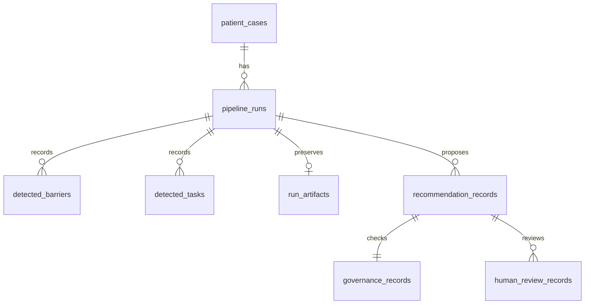

# Backend and database review guide

The local research prototype now saves complete runs, recommendations, governance outcomes, and append-only human review decisions in PostgreSQL. All operations remain research records; approving a proposal does not execute it or authorize discharge.

## Additive migration

```sh
python -m db.migrate
```

Revision: `2026_11_review_storage_v1`. The migration takes a PostgreSQL transaction-level advisory lock, creates five new tables and a run-history index, and records a schema checksum. It can be rerun safely. It does not drop tables or modify existing row contents. The original four-table database was backed up locally before migration and verified unchanged immediately afterward. Database backups and credentials are excluded from the review package.

| Table | Purpose |
|---|---|
| `patient_cases` | Current synthetic case record; unchanged existing design |
| `pipeline_runs` | Separate execution IDs, model metadata, outcomes and evaluation |
| `detected_barriers` / `detected_tasks` | Per-run evidence findings and tasks |
| `run_artifacts` | One full immutable response snapshot per new run, with input and payload digests |
| `recommendation_records` | Accepted proposals, unique within a run |
| `governance_records` | Policy and approval outcomes tied by foreign key to a saved recommendation |
| `human_review_records` | Append-only decisions, tied by foreign key to a saved recommendation and run |
| `schema_migrations` | Applied revision and DDL checksum |

The case upsert, run, findings, tasks, proposals, governance, and full response commit in one transaction. An error rolls back all of them. Concurrent case updates use an upsert. Original runs remain available as legacy summaries; new full artifacts are not fabricated for old executions.



## API

| Endpoint | Behavior |
|---|---|
| `GET /health` | Process liveness; no inference or database dependency check |
| `GET /ready` | Bounded database/schema and Ollama/model availability checks; HTTP 503 when unavailable |
| `GET /runs?limit=25&offset=0&case_id=CASE-007` | Paginated history, optional case filter; maximum page size 100 |
| `GET /runs/{run_id}` | Verify and restore a full saved response plus review history, or an explicit legacy summary |
| `POST /reviews` | Durable, run-bound research decision with retry-safe request ID |
| `GET /research` | Frozen research metrics and limitations |

Example review body (use IDs and values returned by your saved run):

```json
{
  "run_id": "<saved run UUID>",
  "request_id": "<new UUID, reused for retries of this exact request>",
  "case_id": "CASE-007",
  "recommendation_id": "<saved recommendation ID>",
  "task_id": "reconcile_meds",
  "action": "Complete medication reconciliation",
  "decision": "flagged",
  "reviewer_role": "Research Reviewer",
  "notes": "Review evidence before accepting this proposal."
}
```

The backend checks the run, recommendation, case, action, task, governance, full artifact digest and source provenance. Unknown records return 404; mismatched metadata, tampered artifacts, conflicting request-ID reuse, or attempts to approve blocked/unpermitted recommendations return 409. Malformed bodies return 422. Database failures return 503 without exposing connection credentials.

Reusing a request ID with identical content returns the original decision rather than creating a duplicate. A different request ID creates a new append-only decision, preserving the previous one. PostgreSQL is authoritative; JSONL logging is a secondary copy. If its file write fails after commit, the response reports that the database decision was saved. There is no transactional outbox or automatic file-log reconciliation yet.

## Interface and validation

**Run History** restores a saved case, its source data, governance, and latest recorded review state. **Human Review** submits the saved run ID and a retry-stable request UUID. Unsaved offline references cannot record durable review decisions; API-created reference runs saved with persistence are explicitly labelled as deterministic references.

Validation includes isolated SQLite contract tests and live PostgreSQL checks. The latter saved all seven synthetic reference cases, matched all their expected barrier/task IDs, restored verified artifacts, rejected forged metadata, and demonstrated that simultaneous duplicate review submissions create one record. A flagged validation decision is explicitly labelled `Automated Demo Validation`, not a clinician or professor decision.

```sh
python -m scripts.review_check --live
```

## Remaining limits

This is a localhost research application, without authenticated reviewer identity, role-based access control or production deployment hardening. `reviewer_role` is a self-reported label. HMAC signatures require separately trusted key management and do not prove clinical truth. Database rows are append-only by application behavior, not protected against a database administrator rewriting history. There is no production job queue, automatic backup rotation or independent clinical validation. These are explicit future tasks, not completed capabilities.
